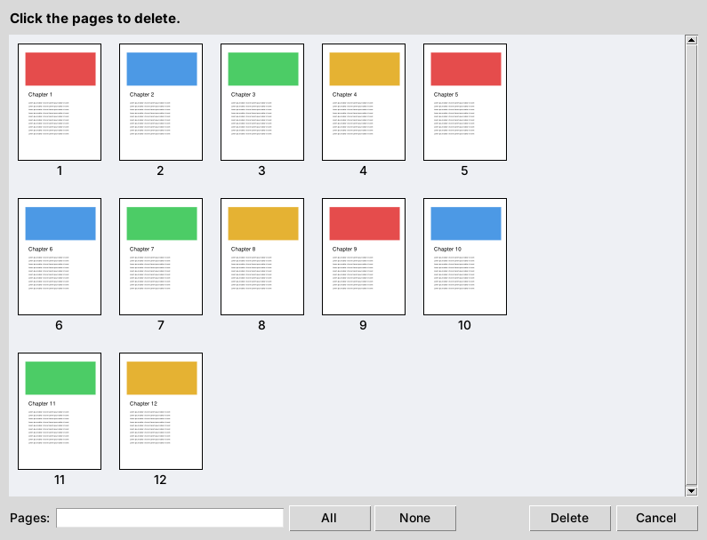
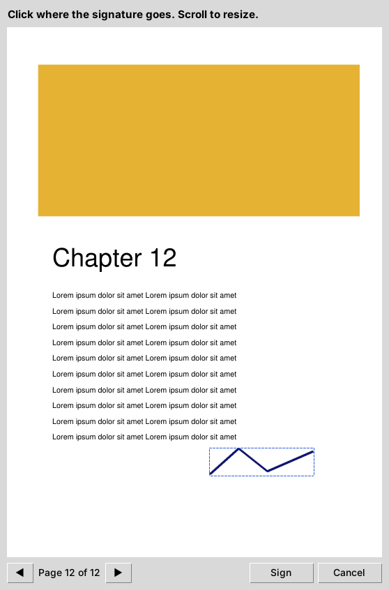
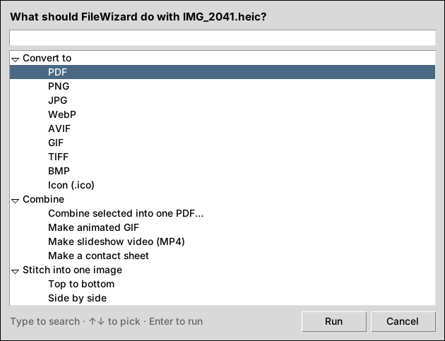
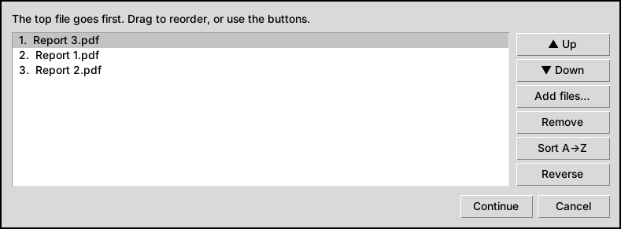
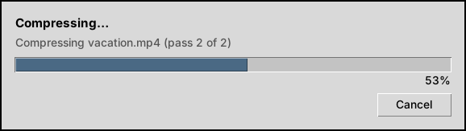
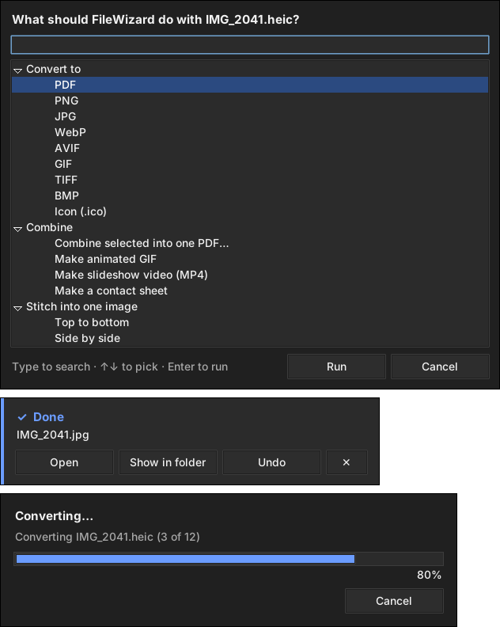

# FileWizard

**Right-click any file → FileWizard ▸ → done.** Convert, compress, merge, trim and fix files
straight from Windows File Explorer, without uploading them to random websites.
Everything runs locally on your PC.

```
FileWizard ▸
    Convert to ▸      PDF · PNG · JPG · WebP · HEIC · AVIF · GIF · TIFF · ICO …
    ─────────
    Merge selected PDFs…          ← only appears when you've selected several
    ─────────
    Compress
    Pages ▸           Split · Extract… · Delete… · Reverse · Remove blank pages
    Rotate ▸          Right · Left · 180°
    Edit ▸            Page numbers · Watermark… · Black & white · Flatten forms
    Password ▸        Add… · Remove…
    ─────────
    Make searchable (OCR)
    Extract ▸         Images
    ─────────
    More ▸            ZIP · 7z · Rename selected… · Checksum
    ─────────
    All actions…      ← searchable list of everything
```

The menu adapts to what you right-clicked and how many files are selected.

## What it can do

| Right-click on… | Actions |
|---|---|
| **Images** — JPG, PNG, WebP, **HEIC** (iPhone), AVIF, GIF, TIFF, BMP, ICO, **SVG**, PSD, TGA, JPEG 2000, **camera RAW** (CR2, CR3, NEF, ARW, DNG, ORF, RW2, RAF…) | Convert to PDF/PNG/JPG/WebP/HEIC/AVIF/GIF/TIFF/BMP/ICO (animations stay animated) · Combine into one PDF · **Animated GIF / slideshow video** from selected photos · Stitch into one image · Contact sheet · Compress (same look, or **under 1 MB / 500 KB / 200 KB / any size** for upload forms) · Resize (25/50/75%, 4K, Full HD, 1280, 800, custom) · Rotate/flip · Black & white · Crop borders · Pad to square · Watermark · Website/app icon pack · Remove background (AI, optional) · Copy text out of image (OCR) · Remove location/camera info |
| **PDF** | Convert to Word, **Excel (tables)**, PNG, JPG, text · **Merge** · Split · Extract/delete pages (**click thumbnails**) · Reverse · Remove blank pages · Rotate all or **just some pages** · Compress (same look, or **under 5 / 2 / 1 MB / any size**) · **Sign** (place your signature image) · Page numbers · Watermark · Black & white · Flatten forms · Add/remove password · Make searchable (OCR) · Copy all text · Extract images |
| **Video** — MP4, MOV, MKV, WebM, AVI, WMV, FLV, MPG, 3GP, TS/MTS… | Convert to MP4/MKV/WebM/MOV/AVI/WMV/GIF, or **"MP4 that plays everywhere"** (fixes iPhone HEVC/HDR clips) (instant, lossless when only the container changes) · Extract audio (MP3/M4A/WAV) · **Compress** (same look, or **fit under 10 MB / 25 MB / 100 MB / any size** for Discord, email…) · Resize 1080p/720p/480p · **Trim** · Rotate/flip · Speed 0.5×–2× · Fix volume · Remove sound · **Join** selected · Save a frame / extract frames · Burn in / extract subtitles · iPhone ringtone · **video + audio → new soundtrack** |
| **Audio** — MP3, WAV, FLAC, M4A, AAC, OGG, Opus, WMA, AIFF… | Convert to MP3/M4A/WAV/FLAC/OGG/Opus/AIFF · Compress · Trim · Speed · Fix volume · Join selected |
| **Word / PowerPoint / Excel** (incl. old .doc/.ppt/.xls and OpenDocument) | Convert to PDF · slides/pages → PNG images · Word → text · old formats → .docx/.pptx/.xlsx · **Compress** (shrinks embedded photos) · Combine into one PDF |
| **Ebooks** — EPUB, MOBI, FB2, XPS, CBZ | Convert to PDF or text |
| **Markdown / HTML / text** | Convert to PDF (Markdown also to a styled web page) |
| **Data** — CSV, TSV, Excel, JSON | CSV → printable PDF table · Convert between CSV ⇄ Excel ⇄ JSON (keeps leading zeros, handles `;` CSVs and Windows encodings) |
| **Archives** — ZIP, 7z, TAR, GZ, RAR, ISO… | Extract here · Extract to folder (protected against malicious "zip-slip" archives) |
| **Any file or folder** | Compress to ZIP / 7z · Rename selected… (`Trip {n}` → Trip 01, Trip 02…; `{taken}` = photo date) · Show details (size, dimensions, duration, camera, **GPS warning**) · Checksum (SHA-256) · Folders: combine all PDFs/images inside into one PDF |
| **A mix** (e.g. 2 PDFs + a photo + a Word doc) | **Combine selected into one PDF**, with a bookmark per file |
| **Empty space inside a folder** | **Paste clipboard image as file** (Win+Shift+S → right-click → PNG) · Paste clipboard text as .txt · Combine the PDFs/images in this folder into one PDF |

Results are saved **next to the original** (or in a `FileWizard` subfolder, your choice in Settings), never overwriting anything (`report (merged).pdf`,
`photo (2).png`). When a job finishes, a small notification offers **Open**, **Show in folder** and **Undo** (sends what was just created to the Recycle Bin).
Long jobs show a progress bar with **Cancel**.

## Screenshots

<sub>Captured from the real dialogs on a Linux test display; on Windows they use the native theme and
follow your light/dark setting (dark mode shown below the table).</sub>

| Pick pages by clicking thumbnails | Sign a PDF | Search every action ("All actions…") |
|---|---|---|
|  |  |  |
| **Order files before merging** | **Progress with Cancel** | **Done: Open / Show in folder / Undo** |
|  |  |  |



## Tips

- **Windows 11:** hold **Shift** while right-clicking to skip "Show more options".
- **Select several files first** to get batch actions: Merge/Combine, Join, Stitch, GIF/slideshow, ZIP, Rename.
  Mixed selections (say a video + a song) offer what makes sense for that mix.
- **Your recent actions float to the top** of the menu, so a daily "HEIC → JPG" is one hover.
- **"All actions…"** opens a searchable list: type `heic`, `merge` or `under 2` and press Enter.
- **Screenshot → file:** Win+Shift+S, then right-click empty space in a folder → *Paste clipboard image as file*.
- **Changed your mind?** The *Done* notification has **Undo** (sends the new files to the Recycle Bin).
- **Upload limits:** *Compress ▸ Under 2 MB* (PDFs), *Under 500 KB* (images), *Under 10 MB* (videos).

## Install

**Easiest: the installer (no Python needed).**
Download `FileWizard-Setup.exe` from the latest successful
[CI run](../../actions/workflows/ci.yml) (Artifacts → *FileWizard-Setup*), run it, done.
It asks for admin rights once (it installs to Program Files for all users, because Windows reliably
loads all-users menu extensions: we measured this in CI) and puts the full menu in place.

**From source (developers):**
```
pip install .
python -m filewizard install        # classic menu (see "Two menu modes")
```

### Optional extras
- **Microsoft Office or [LibreOffice](https://www.libreoffice.org/)**: needed for Word/PowerPoint/Excel → PDF
  (Office gives identical output to *Save as PDF*; LibreOffice is the free fallback).
- **[Tesseract OCR](https://github.com/UB-Mannheim/tesseract/wiki)**: for *Make searchable* and
  *Copy text out of image*.
- **AI background removal**: `pip install rembg` (downloads a ~170 MB model on first use).
- **7-Zip**: lets *Extract* open RAR/ISO on older Windows versions.

Check what's available: Start menu → *FileWizard settings* → *Check optional tools*, or `filewizard doctor`.

### Windows 11
The new short right-click menu only accepts apps shipped as signed Store packages, so
FileWizard is under **"Show more options"**, or press **Shift + right-click** to go straight there.

## Two menu modes

| | **Full menu** (installer) | **Classic** (`pip` install) |
|---|---|---|
| How | Small native shell extension (`fwshell.dll`), registered for all users | Plain registry entries (per user, no admin) |
| Size | Every action | Windows caps these menus at **16 entries**, so the most-used ones are shown, plus **All actions…** |
| Multi-select aware | ✅ "Merge" only appears with 2+ files; mixed selections show shared actions | Shows every action; asks to add files if needed |
| One process per click | ✅ | Explorer starts one process per file; FileWizard gathers them into one job |
| Icons next to items | ✅ (from Windows' own icon font) | – |

The 16-entry limit isn't a guess: CI measured it on real Windows (see `docs/BUILD_LOG.md`).
If the full menu ever doesn't show on a PC (unusual security policies), switch to Classic in
*FileWizard settings → Menu style*.

## Command line

Everything works from a terminal too:

```
filewizard list                                   # every action and its ID
filewizard menu .mp4                              # preview the right-click menu for a type
filewizard run combine-pdf a.pdf photo.jpg memo.docx
filewizard run vid-under-custom clip.mov -p mb=8
filewizard run pdf-extract big.pdf -p pages=1-3,7,10-
filewizard run media-trim talk.mp4 -p span=1:30-4:05
filewizard settings | doctor | install | uninstall
```

Page ranges: `1-3,5` · `8-` (to the end) · `-3` · `last`. Times: `90`, `1:30`, `0:10-1:25`, `1:00-`.

## How it works

- **Menu.** Native mode: `native/fwshell.cpp` implements `IContextMenu` and reads a manifest
  (`%LOCALAPPDATA%\FileWizard\menu.tsv`) that `filewizard install` generates from the action
  catalog in `filewizard/operations.py`, so new actions need no recompile. Classic mode uses
  `HKCU\Software\Classes\SystemFileAssociations\<ext>\shell\FileWizard` cascades plus a `*`
  entry with an `AppliesTo` filter for unknown types.
- **Multi-select (classic mode).** Explorer starts one process per selected file;
  `filewizard/collector.py` elects a leader via an atomic lock folder, which gathers all paths
  and runs the action once.
- **Engines.** PyMuPDF (PDF, ebooks, SVG), Pillow + pillow-heif + rawpy (images), bundled
  ffmpeg via imageio-ffmpeg (video/audio), pdf2docx, Office COM / LibreOffice, py7zr, openpyxl.
  PyMuPDF is AGPL: fine for personal use; check the license before distributing commercially.
- **Testing.** CI runs the unit tests on Windows and Linux, then drives the **real Windows
  shell context menu**: it builds the menu through the same COM interfaces Explorer uses,
  hovers submenus and clicks items (including multi-select merges and mixed selections),
  against both a dev install and the frozen installer build.

## Development

```
pip install -e ".[dev]"
python -m pytest                    # ~100 tests; media tests use the bundled ffmpeg
```
